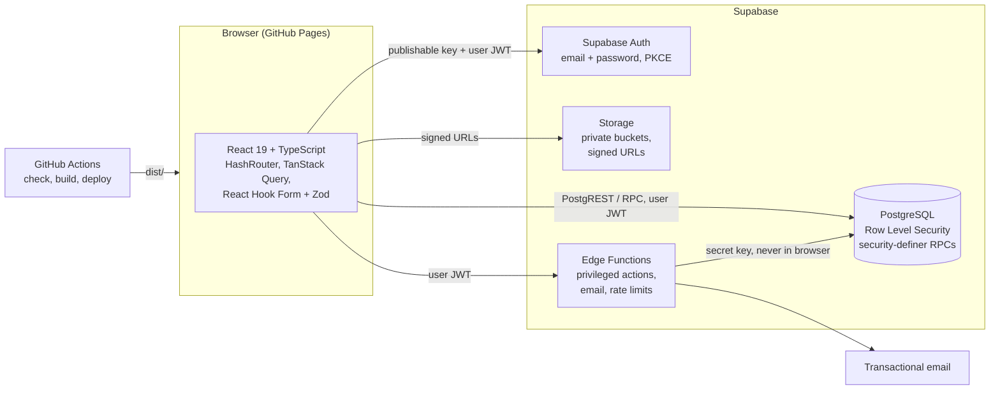

# Architecture

ScoutLink OC is a static React application served from GitHub Pages, backed by Supabase for authentication, data, files and trusted server-side operations. All authorization is enforced by the database and Edge Functions; the browser only decides what to *show*.

## 1. Overview



### Principles

1. **The database is the security boundary.** Every exposed table has Row Level Security (RLS) with default-deny policies. Hidden buttons and route guards improve the experience; they never grant or deny access by themselves.
2. **No privileged keys in the browser.** The frontend uses only the Supabase *publishable* key. The build and the app both refuse to run if a `VITE_` variable contains a secret or `service_role` key.
3. **Privileged changes go through trusted code.** Role assignments, verification, approvals and anything that must be atomic (registration, waitlist promotion) run in `security definer` Postgres functions or Edge Functions that re-check the caller's verified roles.
4. **Roles come from verified records.** `role_assignments` is written only by administrators through audited functions. Profile fields a user can edit never affect permissions.
5. **No application data in the browser.** Server state lives in Supabase and is cached in memory by TanStack Query. `localStorage` holds only UI preferences (the color theme) and Supabase's own session.
6. **Static hosting friendly.** `HashRouter` (`/#/route`) keeps deep links and reloads working on GitHub Pages; the base path comes from the repository name at build time.
7. **Youth safety by default.** Youth accounts, youth messaging and real data stay disabled until the council approves the required procedures (see [SECURITY.md](SECURITY.md)).

### Request flow example: registering for an event (Milestone 5)

1. The page calls the `register_for_event(event_id, participant_ids)` RPC with the user's JWT.
2. The function locks the event row (`select … for update`), checks the caller's verified role and troop, eligibility, registration window, guardian permissions and duplicates, then inserts registrations or waitlist entries in one transaction.
3. It writes notifications and an audit entry, and returns the outcome. Capacity is never checked in the browser.

## 2. Frontend structure

| Layer | Folder | Responsibility |
| --- | --- | --- |
| Routing | `src/app/` | Route table (`routes.tsx`, lazy-loaded pages), providers |
| Pages | `src/pages/` | One component per route; compose components and hooks |
| Components | `src/components/` | `ui/` primitives (shadcn/ui pattern on Radix), `layout/`, and feature folders |
| Hooks | `src/hooks/` | Reusable React hooks (`useTheme`, `usePageMeta`, query hooks later) |
| Services | `src/services/` | Typed Supabase queries and RPC calls (Milestone 2+) |
| Library | `src/lib/` | Pure helpers: config, validation schemas, dates, permissions (UX mirror of database rules) |
| Contexts | `src/contexts/` | Theme now; session/auth in Milestone 2 |
| Tests | `src/tests/`, `build/*.test.ts`, `e2e/` | Vitest unit/integration tests, Playwright end-to-end tests |

### Folder structure (finalized plan)

Items marked ✅ exist now; the rest arrive in the milestone shown.

```text
scoutlink-oc/
├── .github/
│   ├── dependabot.yml                 ✅ weekly dependency PRs
│   └── workflows/
│       ├── ci.yml                     ✅ checks + e2e on every push/PR
│       └── deploy.yml                 ✅ check, build, deploy to Pages
├── build/
│   ├── html-plugins.ts                ✅ CSP meta tag, GitHub Pages 404 redirect
│   └── html-plugins.test.ts           ✅
├── docs/                              ✅ ARCHITECTURE, DATABASE, SECURITY, DEPLOYMENT (+ USER_GUIDE in M2)
├── e2e/                               ✅ Playwright: public site, accessibility
├── public/favicon.svg                 ✅
├── src/
│   ├── app/                           ✅ routes, providers
│   ├── components/
│   │   ├── ui/                        ✅ button, card, badge, inputs, form, sheet, dropdown, accordion, …
│   │   ├── layout/                    ✅ header, footer, frame, page header, error boundary, skeleton
│   │   ├── marketing/                 ✅ hero illustration, legal draft wrapper
│   │   ├── auth/                      ✅ auth shell, password input
│   │   ├── troops/ service-units/     M3
│   │   ├── messages/                  M4
│   │   ├── events/ calendar/          M5
│   │   ├── projects/                  M6
│   │   └── admin/                     M7
│   ├── contexts/                      ✅ theme · M2 auth/session
│   ├── hooks/                         ✅
│   ├── lib/
│   │   ├── base-path.ts config-schema.ts env.ts   ✅
│   │   ├── validation.ts date.ts focus.ts site.ts ✅
│   │   ├── supabase.ts auth.ts permissions.ts     M2
│   ├── pages/
│   │   ├── public/ auth/              ✅
│   │   ├── dashboard/ account/        M2
│   │   ├── explore/                   M3
│   │   ├── messages/ collaborations/  M4
│   │   ├── events/ calendar/          M5
│   │   ├── projects/                  M6
│   │   └── admin/                     M7
│   ├── services/                      M2+
│   ├── types/database.ts              M2 (generated with `supabase gen types`)
│   └── tests/                         ✅
├── supabase/
│   ├── config.toml                    M2
│   ├── migrations/                    M2+ (one migration per milestone feature set)
│   ├── functions/                     M2+ (Edge Functions)
│   ├── tests/                         M2+ (SQL/pgTAP RLS tests)
│   └── seed.sql                       M3 (fictional, removable demo data)
├── .env.example  .gitignore  .nvmrc  components.json
├── eslint.config.js  playwright.config.ts  vite.config.ts  vitest.config.ts
├── tsconfig.json  tsconfig.app.json  tsconfig.node.json
├── index.html  package.json  package-lock.json  README.md
```

There is no `tailwind.config.ts`: Tailwind CSS v4 is configured in CSS (`src/index.css`, `@theme`).

## 3. Technology choices

| Area | Choice | Notes |
| --- | --- | --- |
| Build | Vite 8 | Rolldown-based; route-level code splitting |
| UI | React 19, TypeScript 6.0 | TypeScript 7 (native compiler) isn't supported by typescript-eslint yet, so 6.0 is the newest compatible release |
| Styling | Tailwind CSS 4, shadcn/ui pattern, Radix primitives, Lucide icons | Components live in `src/components/ui` and can be updated with the shadcn CLI (`components.json`) |
| Fonts | Plus Jakarta Sans (headings), Inter (body) | Google Fonts families, self-hosted via Fontsource so no third-party requests and the strict CSP holds |
| Routing | React Router 8 `createHashRouter` | Works on static hosting; reloads always land on `index.html` |
| Data | Supabase (Postgres, Auth, Storage, Edge Functions), TanStack Query 5 | Added from Milestone 2 |
| Forms | React Hook Form 7, Zod 4 | Same schemas reused for server-side validation where possible |
| Dates | date-fns 4 + @date-fns/tz | Stored as `timestamptz`; displayed in `America/Los_Angeles` by default |
| Tests | Vitest 5 + Testing Library, Playwright 1.65 + axe | E2E runs against a production build under a sub-path |
| Lint | ESLint 10, typescript-eslint, react-hooks, `eslint-plugin-jsx-a11y-x` | The maintained jsx-a11y fork supports ESLint 10; raw-HTML rendering is banned by a lint rule |

## 4. Milestone plan

| # | Milestone | Deliverables | Done when |
| --- | --- | --- | --- |
| 1 | **Foundation** ✅ | Vite/React/TS, Tailwind tokens (light/dark), UI components, header/mobile nav/footer, all public pages, HashRouter, CSP, Pages 404 redirect, CI + deploy workflows, docs | Typecheck, lint, unit, e2e and build pass; deploys to Pages |
| 2 | Database and authentication | Supabase project setup, migrations for identity tables (`profiles`, `role_assignments`, affiliations, `verification_requests`, `audit_logs`, `contact_messages`), RLS + tests, Supabase client, sign-up/sign-in/out, email confirmation, password reset, session persistence, onboarding, account states, protected routes, account status page, deactivation and deletion requests | Auth flows work against a real project; unverified users can reach only their own status; RLS tests reject cross-user access |
| 3 | Troop and service unit directory | Directory tables/views exposing only shareable fields, aggregate counts, search/filter/sort with bounded pagination, troop and service unit profiles with tabs, fictional seed data with removal script | Filters work server-side; private fields are unreachable by changing IDs |
| 4 | Adult networking | Contact requests (create, accept, decline, report) with rate limits, conversations and messages with participant-only RLS, unread counts, archive, block, notifications center | E2E: request → accept → conversation; non-participants can't read messages |
| 5 | Events and calendars | Event CRUD, approval states, visibility levels, atomic registration and waitlist RPCs, guardian permission model (disabled for youth), organizer dashboard, exports, month/week/list calendars, ICS export where authorized | Capacity can't be exceeded under concurrent requests; private events never appear in others' queries |
| 6 | Project management | Projects, members, configurable Kanban columns with keyboard-accessible drag and drop, tasks, comments, milestones, budget, fundraising and travel planners, private files, printable reports | Tasks persist ordering; non-members can't read projects |
| 7 | Administration | Admin dashboard, user verification, scoped role assignment, troop and service unit management, event and opportunity moderation, content reports, audit log viewer | All admin RPCs re-check scope server-side; every sensitive action is audited |
| 8 | Production readiness | Full security test pass, accessibility audit, responsive QA, performance budget, threat-model review, USER_GUIDE.md, final deployment checklist | Acceptance criteria in the master prompt are met or explicitly listed as outstanding |

Youth accounts and youth messaging remain disabled after Milestone 8 until the council approves the prerequisites in [SECURITY.md](SECURITY.md#age-and-guardian-restrictions).
