# Database design

> **Status:** design for review. No migrations exist yet; they arrive in Milestone 2 (identity) and later milestones (one migration set per feature area). Table and column names below are the plan the migrations will follow.

PostgreSQL on Supabase. All primary keys are `uuid` (`gen_random_uuid()`), all timestamps are `timestamptz`, and every table exposed through the API has Row Level Security enabled with default-deny policies.

## Conventions

- `snake_case` names; plural table names; `<table>_id` foreign keys.
- `created_at timestamptz not null default now()`, `updated_at` maintained by a shared trigger.
- Soft deletion with `archived_at` / `deleted_at` where history matters (troops, service units, events, projects). Hard deletion for personal data on approved deletion requests.
- Enumerations as Postgres `enum` types where the set is closed (states, roles); lookup tables where admins may extend them (interest tags, event categories).
- Unique constraints prevent duplicate memberships, registrations and pending requests.
- Official numbers (troop size, years active) carry provenance: `source` (`fictional_demo`, `council_record`, `self_reported`), `as_of` date and `verified_by`.
- Every demo row has `is_demo boolean not null default false`; the seed sets it to `true`, and `delete … where is_demo` removes demo data without touching real records.

## Entity relationship diagram

```mermaid
erDiagram
  auth_users ||--|| profiles : "has"
  profiles ||--o{ role_assignments : "holds"
  profiles ||--o{ verification_requests : "submits"
  profiles ||--o{ troop_affiliations : "affiliated via"
  profiles ||--o{ service_unit_affiliations : "affiliated via"
  service_units ||--o{ troops : "contains"
  service_units ||--o{ service_unit_affiliations : ""
  troops ||--o{ troop_affiliations : ""
  troops ||--o{ troop_levels : "serves"
  troops ||--o{ troop_interests : "tagged"
  profiles ||--o{ guardian_relationships : "guardian of (future)"
  profiles ||--o{ user_consents : "gives (future)"

  troops ||--o{ contact_requests : "receives"
  troops ||--o{ collaboration_requests : "proposes / receives"
  contact_requests ||--o| conversations : "opens when accepted"
  conversations ||--o{ conversation_participants : ""
  conversations ||--o{ messages : ""
  profiles ||--o{ conversation_participants : ""

  events ||--o{ event_approvals : ""
  events ||--o{ event_registrations : ""
  events ||--o{ event_waitlist : ""
  events ||--o{ event_updates : ""
  event_registrations ||--o| event_attendance : ""
  troops ||--o{ events : "hosts"
  service_units ||--o{ events : "hosts"

  projects ||--o{ project_members : ""
  projects ||--o{ project_columns : ""
  project_columns ||--o{ project_tasks : ""
  project_tasks ||--o{ task_assignees : ""
  project_tasks ||--o{ task_comments : ""
  projects ||--o{ project_milestones : ""
  projects ||--o{ project_budget_items : ""
  projects ||--o{ project_files : ""
  projects ||--o{ project_activity_logs : ""
  troops ||--o{ projects : "affiliated"

  opportunities ||--o{ opportunity_requests : ""
  profiles ||--o{ notifications : "receives"
  profiles ||--o{ content_reports : "files"
  profiles ||--o{ audit_logs : "actor"
```



## Tables

### Identity and organizations

| Table | Key columns | Notes |
| --- | --- | --- |
| `profiles` | `id` (= `auth.users.id`), `display_name`, `bio`, `interests text[]`, `general_location`, `account_state` (`pending_verification`, `active`, `suspended`, `deactivated`), `notification_prefs jsonb`, `privacy_prefs jsonb`, `deletion_requested_at` | Created by trigger on sign-up. Users may update only display/bio/interests/location/preferences (column-level grants). `account_state` changes only through admin RPCs. |
| `role_assignments` | `profile_id`, `role` (`platform_admin`, `council_admin`, `service_unit_coordinator`, `troop_leader`, `adult_volunteer`, `girl_member`, `guardian`), `scope_type` (`platform`, `council`, `service_unit`, `troop`), `scope_id`, `granted_by`, `granted_at`, `revoked_at` | Source of truth for permissions. Multiple scoped roles per person. Unique on (`profile_id`, `role`, `scope_type`, `scope_id`) where not revoked. No insert/update policy for users; written only by `grant_role` / `revoke_role` functions. |
| `service_units` | `name`, `number`, `region` (`north`, `central`, `south`, `coastal`, …), `description`, `founded_year`, `founded_year_source`, `visibility`, `archived_at`, `is_demo` | |
| `troops` | `number`, `service_unit_id`, `introduction`, `approx_size`, `size_source`, `size_as_of`, `founded_year`, `collaboration_status` (`open`, `limited`, `closed`), `visibility` (`council_members`, `public_listing`), `archived_at`, `is_demo` | Levels and interests in child tables. Private details (meeting place, schedule) live in `troop_private_details`, readable only by that troop's verified adults. |
| `troop_levels` | `troop_id`, `level` (`daisy` … `ambassador`) | A service unit's levels are derived from its troops, never stored on the service unit. |
| `troop_interests` | `troop_id`, `interest_id` → `interest_tags` | |
| `troop_affiliations` / `service_unit_affiliations` | `profile_id`, scope id, `status` (`requested`, `approved`, `rejected`, `ended`), `approved_by`, timestamps | A request at onboarding creates `requested`; only admins approve. |
| `verification_requests` | `profile_id`, `requested_role`, `requested_scope`, `notes`, `status`, `reviewed_by`, `reviewed_at` | Drives the admin verification queue. |
| `guardian_relationships` | `guardian_id`, `member_id`, `status`, `verified_by` | **Future, gated.** Created but unusable (no policies grant access) until youth access is approved. |
| `user_consents` | `profile_id`, `consent_type`, `version`, `granted_at`, `withdrawn_at`, `evidence_ref` | **Future, gated.** Records policy agreements now; youth/guardian consent types stay disabled. |

### Networking

| Table | Key columns | Notes |
| --- | --- | --- |
| `contact_requests` | `requester_id`, `requesting_troop_id`, `recipient_troop_id`, `category` (`joint_event`, `service_opportunity`, `workshop`, `volunteer_request`, `general_inquiry`), `reason`, `message`, `status` (`pending`, `accepted`, `declined`, `reported`, `withdrawn`), `responded_by`, `conversation_id` | Created only via `create_contact_request` (verifies adult, affiliation, rate limit: e.g. 5/day, 1 pending per troop pair). Partial unique index on pending pairs. |
| `collaboration_requests` | `from_troop_id`, `to_troop_id`, `kind`, `proposal`, `status` | Joint events and projects. |
| `conversations` | `kind` (`adult_direct`, `group`), `created_from_request_id`, `archived_at` | |
| `conversation_participants` | `conversation_id`, `profile_id`, `last_read_at`, `archived_at`, `muted` | RLS on messages checks membership here. |
| `messages` | `conversation_id`, `sender_id`, `body` (plain text, length-limited), `created_at`, `edited_at`, `deleted_at` | Rendered as text only; never as HTML. |
| `user_blocks` | `blocker_id`, `blocked_id` | Auxiliary: blocks stop new requests and messages. |

### Events

| Table | Key columns | Notes |
| --- | --- | --- |
| `events` | `title`, `description`, `category_id`, `host_troop_id` / `host_service_unit_id`, `organizer_id`, `starts_at`, `ends_at`, `time_zone` (default `America/Los_Angeles`), `format` (`in_person`, `online`, `hybrid`), `general_location`, `eligible_levels level[]`, `capacity`, `registration_opens_at`, `registration_closes_at`, `visibility` (`troop_private`, `service_unit`, `council_members`, `public_listing`), `state` (`draft`, `submitted`, `changes_requested`, `approved`, `published`, `cancelled`, `completed`), `requirements`, `accessibility_info`, `notes`, `guardian_permission_required` | State transitions enforced by a trigger and `transition_event_state` RPC. Girl-created events can't skip `submitted`. Location-, eligibility- or safety-changing edits after approval return the event to `submitted`. |
| `event_private_details` | `event_id`, `venue_address`, `logistics` | Visible only to organizers and confirmed participants. |
| `event_approvals` | `event_id`, `reviewer_id`, `decision`, `comment` | History of reviews. |
| `event_registrations` | `event_id`, `participant_profile_id` or `participant_troop_id`, `registered_by`, `status` (`confirmed`, `cancelled`), `guardian_permission_status` | Unique per event + participant. Inserted only through `register_for_event`. |
| `event_waitlist` | `event_id`, participant, `position`, `promoted_at` | Promotion via `promote_waitlist` (same transaction as a cancellation). |
| `event_updates` | `event_id`, `author_id`, `body`, `notify` | |
| `event_attendance` | `registration_id`, `status`, `marked_by` | |

### Projects

| Table | Key columns | Notes |
| --- | --- | --- |
| `projects` | `name`, `description`, `type` (`service`, `bronze_award`, `silver_award`, `gold_award`, `workshop`, `fundraiser`, `meeting`, `joint_event`, `travel`, `leadership`), `lead_profile_id`, `troop_id`, `goals`, `starts_on`, `target_on`, `visibility`, `status` (`planning`, `awaiting_approval`, `approved`, `in_progress`, `completed`, `archived`), `adult_advisor_id` | |
| `project_members` | `project_id`, `profile_id`, `role` (`admin`, `member`, `advisor`), `status` | Cross-troop invitations start `invited` and need the other troop leader's approval. |
| `project_columns` | `project_id`, `name`, `position` | Default To Do / In Progress / Completed. |
| `project_tasks` | `project_id`, `column_id`, `title`, `description`, `due_on`, `priority`, `position numeric`, `completed_at` | Fractional `position` keeps reordering to one update. |
| `task_assignees`, `task_comments` | | |
| `project_milestones` | `title`, `description`, `due_on`, `completed_on`, `status` | `milestone_tasks` links related tasks. |
| `project_budget_items` | `category`, `kind` (`expense`, `funding`, `revenue_plan`), `estimated_cents`, `actual_cents`, `approval_status`, `receipt_file_id` | Money in integer cents. |
| `project_files` | `storage_path`, `file_name`, `mime_type`, `size_bytes`, `uploaded_by` | Private bucket; access via signed URLs after membership check. Size and type limits enforced by storage policies. |
| `project_activity_logs` | `actor_id`, `action`, `details jsonb` | |
| `travel_plans` | `project_id`, checklists, supervision plan | Auxiliary; visible only to trip participants and advisors. |

### Community and oversight

| Table | Notes |
| --- | --- |
| `opportunities` | `title`, `organizer_troop_id`, `category`, `description`, `eligible_audience`, `region`, `deadline`, `approval_status`, `visibility`. |
| `opportunity_requests` | Interest/requests to an opportunity; contact flows through the platform. |
| `notifications` | `recipient_id`, `type`, `resource_type`, `resource_id`, `title`, `read_at`. Inserted only by triggers/RPCs; users can only mark their own as read. |
| `content_reports` | `reporter_id`, `target_type`, `target_id`, `reason`, `status` (`open`, `in_review`, `resolved`, `escalated`), `assigned_to`, `resolution`. |
| `audit_logs` | `actor_id`, `action`, `target_type`, `target_id`, `scope`, `metadata jsonb`, `created_at`. Append-only (no update/delete grants). Never stores passwords, tokens or message bodies. |
| `contact_messages` | Public contact form (Milestone 2): insert-only for `anon` through a rate-limited Edge Function; readable by platform admins. |
| `rate_limits` | Auxiliary counters used by RPCs and Edge Functions. |

## Authorization model

Helper functions live in a `private` schema that isn't exposed through the API, are `security definer` with a fixed `search_path`, and read only `auth.uid()` plus `role_assignments`:

- `private.is_active()`: caller's `account_state = 'active'`.
- `private.has_role(role, scope_type, scope_id)`: an unrevoked assignment matches (council admins match all council scopes).
- `private.is_troop_leader(troop_id)`, `private.coordinates_service_unit(service_unit_id)`, `private.is_project_member(project_id)`, `private.is_conversation_participant(conversation_id)`.

Policies call these helpers, for example:

```sql
-- Only verified participants can read messages; guessing a conversation id returns nothing.
create policy "participants read messages" on public.messages
  for select to authenticated
  using (private.is_active() and private.is_conversation_participant(conversation_id));
```

Directory reads go through `security invoker` views (or RLS-protected tables) that expose only shareable columns, so a view can never bypass RLS. Aggregate counts come from approved aggregate tables or functions that return counts without row data.

## Indexes (initial set)

- Foreign keys used in joins and RLS checks (`role_assignments(profile_id)`, `troop_affiliations(troop_id, status)`, `conversation_participants(profile_id)`, `messages(conversation_id, created_at desc)`, `event_registrations(event_id)`, `project_members(profile_id)`, `notifications(recipient_id, read_at)`).
- Directory search: `troops(service_unit_id)`, GIN on `troop_levels`/interests, `pg_trgm` on names and numbers.
- Calendars: `events(starts_at)` partial on `state = 'published'`.
- Partial unique indexes for "one pending request per pair" and "one active registration per participant".

## Migrations

`supabase/migrations/<timestamp>_<name>.sql`, applied with `npx supabase db push`. Each migration ships with SQL tests (pgTAP via `supabase test db`) that prove unauthorized reads and writes are rejected. Type definitions are generated into `src/types/database.ts` with `npx supabase gen types`.
