# Database design

> **Status:** the identity, verification, audit and contact tables are **built and tested** (Milestone 2, `supabase/migrations/`). Networking, events, projects and moderation tables below are the plan for Milestones 3–7 and may change when they're built.

PostgreSQL on Supabase. All primary keys are `uuid` (`gen_random_uuid()`), all timestamps are `timestamptz`, and every table exposed through the API has Row Level Security enabled with default-deny policies.

## Conventions

- `snake_case` names; plural table names; `<table>_id` foreign keys.
- `created_at timestamptz not null default now()`, `updated_at` maintained by a shared trigger.
- Soft deletion with `archived_at` / `deleted_at` where history matters (troops, service units, events, projects). Hard deletion for personal data on approved deletion requests.
- Enumerations as Postgres `enum` types where the set is closed (states, roles); lookup tables where admins may extend them (interest tags, event categories).
- Unique constraints prevent duplicate memberships, registrations and pending requests.
- Official numbers (troop size, years active) carry provenance: `source` (`fictional_demo`, `council_record`, `self_reported`), `as_of` date and `verified_by`.
- Every demo row has `is_demo boolean not null default false`; the seed sets it to `true`, and `delete … where is_demo` removes demo data without touching real records.

## Entity relationship diagram

```mermaid
erDiagram
  auth_users ||--|| profiles : "has"
  profiles ||--o{ role_assignments : "holds"
  profiles ||--o{ verification_requests : "submits"
  profiles ||--o{ troop_affiliations : "affiliated via"
  profiles ||--o{ service_unit_affiliations : "affiliated via"
  service_units ||--o{ troops : "contains"
  service_units ||--o{ service_unit_affiliations : ""
  troops ||--o{ troop_affiliations : ""
  troops ||--o{ troop_levels : "serves"
  troops ||--o{ troop_interests : "tagged"
  profiles ||--o{ guardian_relationships : "guardian of (future)"
  profiles ||--o{ user_consents : "gives (future)"

  troops ||--o{ contact_requests : "receives"
  troops ||--o{ collaboration_requests : "proposes / receives"
  contact_requests ||--o| conversations : "opens when accepted"
  conversations ||--o{ conversation_participants : ""
  conversations ||--o{ messages : ""
  profiles ||--o{ conversation_participants : ""

  events ||--o{ event_approvals : ""
  events ||--o{ event_registrations : ""
  events ||--o{ event_waitlist : ""
  events ||--o{ event_updates : ""
  event_registrations ||--o| event_attendance : ""
  troops ||--o{ events : "hosts"
  service_units ||--o{ events : "hosts"

  projects ||--o{ project_members : ""
  projects ||--o{ project_columns : ""
  project_columns ||--o{ project_tasks : ""
  project_tasks ||--o{ task_assignees : ""
  project_tasks ||--o{ task_comments : ""
  projects ||--o{ project_milestones : ""
  projects ||--o{ project_budget_items : ""
  projects ||--o{ project_files : ""
  projects ||--o{ project_activity_logs : ""
  troops ||--o{ projects : "affiliated"

  opportunities ||--o{ opportunity_requests : ""
  profiles ||--o{ notifications : "receives"
  profiles ||--o{ content_reports : "files"
  profiles ||--o{ audit_logs : "actor"
```



## Tables

### Identity and organizations (built in Milestone 2)

| Table | Columns | Rules |
| --- | --- | --- |
| `profiles` | `id` (= `auth.users.id`), `display_name`, `bio`, `interests text[]` (≤12, each ≤40 chars), `general_location`, `account_state` (`pending_verification`, `active`, `suspended`, `deactivated`), `state_reason`, `deletion_requested_at`, `deletion_reason` | Created by a trigger on sign-up, always `pending_verification`. Users can read only their own row and update only `display_name`, `bio`, `interests`, `general_location` (column grants), and only while pending or active. State changes only through functions. |
| `role_assignments` | `profile_id`, `role` (`platform_admin`, `council_admin`, `service_unit_coordinator`, `troop_leader`, `adult_volunteer`, `girl_member`, `guardian`), `scope_type` (`platform`, `council`, `service_unit`, `troop`), `scope_id`, `granted_by`, `granted_at`, `revoked_at`, `revoked_by` | Source of truth for permissions. A check constraint ties each role to its scope type; a partial unique index allows one active copy. No write grants at all: only `admin_*` functions write it. |
| `service_units` | `name`, `code`, `region` (`north`, `central`, `south`, `coastal`, `west`), `description`, `founded_year` + `founded_year_source`, `visibility` (`council_members`, `public_listing`, `hidden`), `is_demo`, `archived_at` | Readable by active members (not hidden or archived) and admins. |
| `troops` | `number`, `service_unit_id`, `introduction`, `approx_size` + `size_source` + `size_as_of`, `founded_year` + `founded_year_source`, `collaboration_status` (`open`, `limited`, `closed`), `visibility`, `is_demo`, `archived_at` | Same read rule. Check constraints require a source for every size or founding year. |
| `troop_levels` | `troop_id`, `level` (`daisy` … `ambassador`) | Readable when the troop is. A service unit's levels are derived from its troops. |
| `verification_requests` | `profile_id`, `requested_role`, `service_unit_id`, `troop_id`, `note`, `status` (`pending`, `approved`, `rejected`, `withdrawn`), `decided_by`, `decided_at`, `decision_note` | One pending request per person (partial unique index). Users read their own; admins read all. Written only by functions. |
| `troop_affiliations`, `service_unit_affiliations` | `profile_id`, scope id, `status` (`requested`, `approved`, `rejected`, `ended`), `verification_request_id`, `decided_by`, `decided_at` | Created as `requested` by onboarding; approved or ended with the request. |
| `user_consents` | `profile_id`, `consent_type` (only `terms_and_privacy` for now), `policy_version`, `granted_at`, `withdrawn_at` | Recorded by onboarding against `private.settings.policy_version`. Youth and guardian consent types aren't allowed by the check constraint. |
| `guardian_relationships` | `guardian_id`, `member_id`, `status`, `verified_by` | **Gated.** All privileges revoked and no policies, so nothing can read or write it until youth access is approved. |
| `contact_messages` | `name`, `email`, `topic`, `message`, `handled_at`, `handled_by` | Written only by `submit_contact_message` (validation, honeypot, rate limits). Readable by admins. |
| `audit_logs` | `actor_id`, `action`, `target_type`, `target_id`, `metadata jsonb`, `created_at` | Append-only, written by `private.audit()`. Readable by admins; never stores passwords, tokens or message bodies. |
| `private.settings` | `key`, `value jsonb` | Not exposed through the API. `youth_access_enabled` (false) and `policy_version`. |
| `private.rate_limits` | `bucket`, `window_start`, `count` | Counters for `private.check_rate_limit()`. |

Planned for Milestone 3: `troop_interests`/`interest_tags`, `troop_private_details` (meeting place and schedule, visible only to that troop's verified adults).

### Networking

| Table | Key columns | Notes |
| --- | --- | --- |
| `contact_requests` | `requester_id`, `requesting_troop_id`, `recipient_troop_id`, `category` (`joint_event`, `service_opportunity`, `workshop`, `volunteer_request`, `general_inquiry`), `reason`, `message`, `status` (`pending`, `accepted`, `declined`, `reported`, `withdrawn`), `responded_by`, `conversation_id` | Created only via `create_contact_request` (verifies adult, affiliation, rate limit: e.g. 5/day, 1 pending per troop pair). Partial unique index on pending pairs. |
| `collaboration_requests` | `from_troop_id`, `to_troop_id`, `kind`, `proposal`, `status` | Joint events and projects. |
| `conversations` | `kind` (`adult_direct`, `group`), `created_from_request_id`, `archived_at` | |
| `conversation_participants` | `conversation_id`, `profile_id`, `last_read_at`, `archived_at`, `muted` | RLS on messages checks membership here. |
| `messages` | `conversation_id`, `sender_id`, `body` (plain text, length-limited), `created_at`, `edited_at`, `deleted_at` | Rendered as text only; never as HTML. |
| `user_blocks` | `blocker_id`, `blocked_id` | Auxiliary: blocks stop new requests and messages. |

### Events

| Table | Key columns | Notes |
| --- | --- | --- |
| `events` | `title`, `description`, `category_id`, `host_troop_id` / `host_service_unit_id`, `organizer_id`, `starts_at`, `ends_at`, `time_zone` (default `America/Los_Angeles`), `format` (`in_person`, `online`, `hybrid`), `general_location`, `eligible_levels level[]`, `capacity`, `registration_opens_at`, `registration_closes_at`, `visibility` (`troop_private`, `service_unit`, `council_members`, `public_listing`), `state` (`draft`, `submitted`, `changes_requested`, `approved`, `published`, `cancelled`, `completed`), `requirements`, `accessibility_info`, `notes`, `guardian_permission_required` | State transitions enforced by a trigger and `transition_event_state` RPC. Girl-created events can't skip `submitted`. Location-, eligibility- or safety-changing edits after approval return the event to `submitted`. |
| `event_private_details` | `event_id`, `venue_address`, `logistics` | Visible only to organizers and confirmed participants. |
| `event_approvals` | `event_id`, `reviewer_id`, `decision`, `comment` | History of reviews. |
| `event_registrations` | `event_id`, `participant_profile_id` or `participant_troop_id`, `registered_by`, `status` (`confirmed`, `cancelled`), `guardian_permission_status` | Unique per event + participant. Inserted only through `register_for_event`. |
| `event_waitlist` | `event_id`, participant, `position`, `promoted_at` | Promotion via `promote_waitlist` (same transaction as a cancellation). |
| `event_updates` | `event_id`, `author_id`, `body`, `notify` | |
| `event_attendance` | `registration_id`, `status`, `marked_by` | |

### Projects

| Table | Key columns | Notes |
| --- | --- | --- |
| `projects` | `name`, `description`, `type` (`service`, `bronze_award`, `silver_award`, `gold_award`, `workshop`, `fundraiser`, `meeting`, `joint_event`, `travel`, `leadership`), `lead_profile_id`, `troop_id`, `goals`, `starts_on`, `target_on`, `visibility`, `status` (`planning`, `awaiting_approval`, `approved`, `in_progress`, `completed`, `archived`), `adult_advisor_id` | |
| `project_members` | `project_id`, `profile_id`, `role` (`admin`, `member`, `advisor`), `status` | Cross-troop invitations start `invited` and need the other troop leader's approval. |
| `project_columns` | `project_id`, `name`, `position` | Default To Do / In Progress / Completed. |
| `project_tasks` | `project_id`, `column_id`, `title`, `description`, `due_on`, `priority`, `position numeric`, `completed_at` | Fractional `position` keeps reordering to one update. |
| `task_assignees`, `task_comments` | | |
| `project_milestones` | `title`, `description`, `due_on`, `completed_on`, `status` | `milestone_tasks` links related tasks. |
| `project_budget_items` | `category`, `kind` (`expense`, `funding`, `revenue_plan`), `estimated_cents`, `actual_cents`, `approval_status`, `receipt_file_id` | Money in integer cents. |
| `project_files` | `storage_path`, `file_name`, `mime_type`, `size_bytes`, `uploaded_by` | Private bucket; access via signed URLs after membership check. Size and type limits enforced by storage policies. |
| `project_activity_logs` | `actor_id`, `action`, `details jsonb` | |
| `travel_plans` | `project_id`, checklists, supervision plan | Auxiliary; visible only to trip participants and advisors. |

### Community and oversight

| Table | Notes |
| --- | --- |
| `opportunities` | `title`, `organizer_troop_id`, `category`, `description`, `eligible_audience`, `region`, `deadline`, `approval_status`, `visibility`. |
| `opportunity_requests` | Interest/requests to an opportunity; contact flows through the platform. |
| `notifications` | `recipient_id`, `type`, `resource_type`, `resource_id`, `title`, `read_at`. Inserted only by triggers/RPCs; users can only mark their own as read. |
| `content_reports` | `reporter_id`, `target_type`, `target_id`, `reason`, `status` (`open`, `in_review`, `resolved`, `escalated`), `assigned_to`, `resolution`. |
| `rate_limits` | Auxiliary counters used by RPCs and Edge Functions. |

## Authorization model

Helper functions live in a `private` schema that PostgREST doesn't expose. They're `security definer` with `search_path = ''` and read only `auth.uid()`, `profiles.account_state` and `role_assignments`:

- `private.current_account_state()`, `private.is_active()`
- `private.has_role(role)`, `private.has_scoped_role(role, scope_type, scope_id)`: active accounts with an unrevoked assignment
- `private.is_platform_admin()`, `private.is_admin()` (platform or council admin)
- `private.audit(action, target_type, target_id, metadata)`, `private.check_rate_limit(bucket, max, window)`
- `private.grant_role_checked(...)`: the only code path that inserts into `role_assignments`

Policies call them with `(select …)` so Postgres evaluates them once per query:

```sql
create policy "verified members read visible troops" on public.troops
  for select to authenticated
  using (((select private.is_active()) and archived_at is null and visibility <> 'hidden') or (select private.is_admin()));
```

Supabase grants every API role broad default privileges on new tables. The migrations revoke them and grant back only what each policy needs, so a missing policy can never fall back to "allowed".

### Functions the app calls (Milestone 2)

All are `security definer`, re-check the caller, and raise short error codes (`forbidden`, `request_pending`, …) that the app turns into plain-language messages (`src/lib/errors.ts`).

| Function | Who | What it does |
| --- | --- | --- |
| `get_my_account()` | signed in | Own profile, account state, active roles with scope names, latest verification request, current policy version |
| `list_affiliation_options()` | signed in | Service units and troops a person can choose during onboarding (never hidden ones) |
| `submit_onboarding(...)` | pending or active | Saves display name and interests, records policy consent, creates a verification request and requested affiliations. Only troop leader, adult volunteer and service unit coordinator can be requested; 5 per day |
| `withdraw_my_verification_request()` | owner | Withdraws a pending request and ends its requested affiliations |
| `deactivate_my_account(reason)` | pending or active | Deactivates; a suspended account can't use this to clear its suspension |
| `request_my_account_deletion(reason)` | signed in | Records the request and deactivates (a suspension stays in place) |
| `admin_list_verification_requests(status)` | admin | The queue, with name and email for checking records |
| `admin_decide_verification(id, approve, note)` | admin | Approves (grants exactly the requested role and scope, activates the account) or rejects (reason required). Nobody can decide their own request |
| `admin_grant_role`, `admin_revoke_role` | admin | Council admins grant non-admin roles; only platform admins grant admin roles; nobody changes their own; youth roles blocked while youth access is off |
| `admin_set_account_state(id, state, reason)` | admin | Activate, suspend or deactivate with a reason; not yourself; council admins can't change platform admins |
| `submit_contact_message(...)` | anyone | Validates, drops honeypot submissions silently, rate-limits per email (3/hour), per network address (10/hour) and overall (200/hour) |
| `private.bootstrap_platform_admin(email)` | SQL editor only | Makes the first platform administrator. Refuses once one exists; not callable through the API |

Every state change writes an `audit_logs` row.

## Indexes (initial set)

- Foreign keys used in joins and RLS checks (`role_assignments(profile_id)`, `troop_affiliations(troop_id, status)`, `conversation_participants(profile_id)`, `messages(conversation_id, created_at desc)`, `event_registrations(event_id)`, `project_members(profile_id)`, `notifications(recipient_id, read_at)`).
- Directory search: `troops(service_unit_id)`, GIN on `troop_levels`/interests, `pg_trgm` on names and numbers.
- Calendars: `events(starts_at)` partial on `state = 'published'`.
- Partial unique indexes for "one pending request per pair" and "one active registration per participant".

## Migrations and tests

| File | Contents |
| --- | --- |
| `supabase/migrations/20261111000100_foundation.sql` | `private` schema, enums, settings, rate limits, audit log |
| `supabase/migrations/20261111000200_identity.sql` | Identity and organization tables, triggers, helper functions, RLS policies and grants |
| `supabase/migrations/20261111000300_identity_functions.sql` | The functions listed above |
| `supabase/setup.sql` | All migrations in one file for pasting into the SQL editor. Generated by `npm run db:bundle`; a unit test fails if it's out of date |
| `supabase/seed.sql` | Fictional demo service units and troops (`is_demo = true`, names marked "fictional demo") |
| `supabase/scripts/remove-demo-data.sql` | Removes every demo record and anything pointing at one; safe to run twice |

Tests (`supabase/tests/*.test.sql`, pgTAP syntax) sign in as different users by setting JWT claims, then check what each can read, write and call: 69 assertions covering anonymous access, pending, verified, suspended and deactivated members, council and platform admins, role escalation, self-approval, youth roles, the guardian table, the audit log and the contact form.

- With the Supabase CLI and Docker: `npx supabase start`, then `npx supabase test db`.
- With any PostgreSQL 15+ server, no Docker: `npm run test:db` (set `PGHOST`, `PGPORT`, `PGUSER`, `PGPASSWORD`). It creates a throwaway database, adds a small stand-in for Supabase's `auth` schema and roles (`supabase/tests/local/`), applies the migrations and seed, runs every test file, then checks the demo-removal script. CI runs this on every push.

`src/types/database.ts` describes the tables and functions the browser uses. With the CLI, `npx supabase gen types typescript --local` regenerates the full set.
